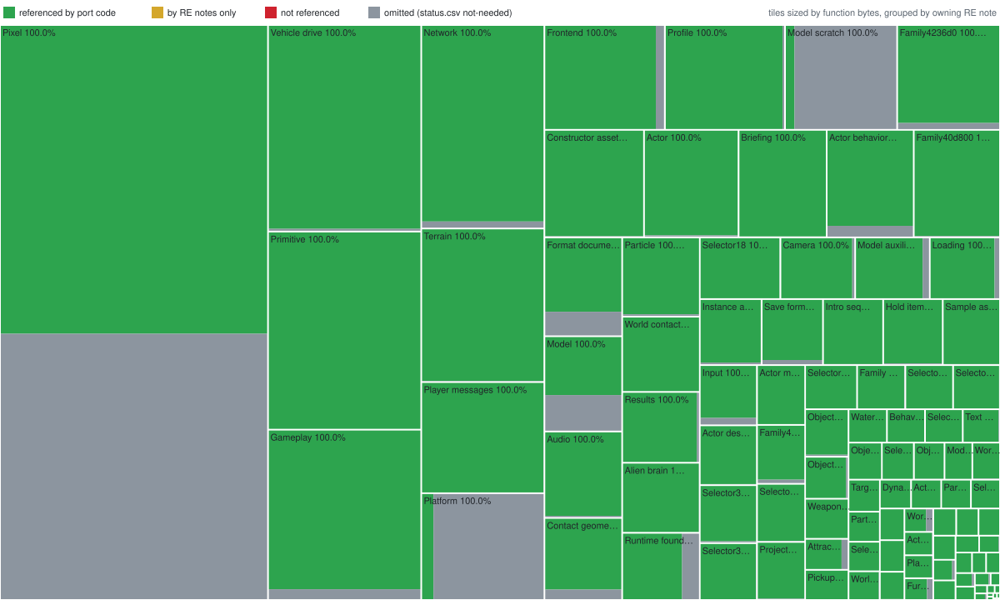

# Reverse-engineering progress

> Generated by `scripts/progress.ps1`. Do not edit by hand.

The Infestation port is a reimplementation, not a matching decompilation.
Nothing is recompiled into the original binary, so there's no byte-exact
"percent decompiled". Instead, this report counts which retail functions the
port's code and RE notes cite by address (for example `004476D0`), as
OpenV2K's report does for V2000.

| Measure | Functions | Share |
|---|---:|---:|
| Game functions in retail `Infest.exe` | 3,781 | |
| Marked not needed (excluded below) | 865 | |
| **Referenced by port code** | **2,916** | **100.0%** |
| Referenced by code or RE notes | 2,916 | 100.0% |
| Library functions (CRT, SEH funclets; not counted) | 799 | |

Manual statuses from [`status.csv`](status.csv):

| Status | Functions |
|---|---:|
| implemented | 0 |
| approximated | 0 |
| documented | 0 |
| not-needed | 865 |

0 `FUN_` citations don't match a retail function
start. Run `scripts/progress.ps1 -ListUnresolved` to list them.

## Map

Each rectangle is the RE note that cites its functions most often, sized by
their bytes and split by state; its label gives the share of its functions the
port's code references. A function only catalog notes cite (small functions,
native receipts, routine notes) joins its nearest neighbour's note; most of
those are compiler stubs that construct and free C++ globals.

Where the code's references are thinnest:

| Note | Not referenced by code | Of them, its neighbours | Referenced |
|---|---:|---:|---:|

## Omitted

Functions marked `not-needed` in [`status.csv`](status.csv) leave the
denominator, each with its reason: dead retail layers and compiler glue
([static construction](../re/RUNTIME_FOUNDATION.md#static-construction-and-teardown)):

| Reason | Functions |
|---|---:|
| glue: an FGDK module's acquire or release thunk (one module record to 0048EE20/0048EEC0, from a dependency table or the boot and exit code); the port's owners construct each module's state | 149 |
| dead: retail's software renderer, never selected (004EB4B0 always builds Direct3D) | 145 |
| compiler glue: a static constructor or destructor thunk | 121 |
| compiler glue: a C++ static initializer thunk (0052E000 table) | 85 |
| compiler glue: an atexit registration of a static destructor | 58 |
| replaced: the port's SDL/OpenGL platform (texture upload kernels for surfaces the port never creates: 16-bit and other depths, palettized pages and the colour-key family; its 32-bit alpha pages use the 8 ported kernels) | 42 |
| replaced: the port's SDL platform (the DirectInput and WinMM device objects, their threads and timers; the port reads its pad once a frame) | 29 |
| replaced: the port's SDL/OpenGL platform (the DirectDraw/Direct3D screen device and its texture pages) | 23 |
| dead: an operator of auxiliary register opcode 36 (table 00544C80), which no retail model carries (tests/model_auxiliary_corpus.rs: every stream's opcodes are 05, 07, 18, 2F, 30, 89, 8C, 8D, 8E, 8F and 95) | 16 |
| replaced: the port's SDL/OpenGL platform (Direct3D texture pages: allocation, packing, upload, eviction and binding; the port gives each sprite its own bordered surface with retail's first-allocation UVs) | 13 |
| replaced: the port's SDL/OpenGL platform (the DirectDraw/Direct3D screen device: its renderer object, lifetime, surface locks and error objects) | 11 |
| replaced: the port's SDL platform (MCI CD audio, message boxes, the command line, DirectX and CRT error texts) | 9 |
| dead: a cylinder contact policy (callback +04, auxiliary opcode 90), which no retail model carries (tests/model_auxiliary_corpus.rs: every stream's opcodes are 05, 07, 18, 2F, 30, 89, 8C, 8D, 8E, 8F and 95) | 6 |
| replaced: the port's SDL platform (the mouse and the button device, which no screen binds, so neither gets an adapter or has an effect) | 6 |
| replaced: the port's SDL/OpenGL platform (DirectDraw device enumeration, display mode and surface format checks) | 6 |
| glue: an import thunk (jmp through the import address table to a system DLL) | 4 |
| dead: no retail analog descriptor has a timer period (INPUT_RUNTIME.md) | 3 |
| replaced: the port's Rust runtime (FGDK wrappers of the C runtime's file and heap calls) | 2 |
| replaced: the port's SDL audio (DirectSound calls and their error objects) | 2 |
| compiler glue: a scalar deleting destructor (calls 00413D00, then frees the object when flag 1 is set) | 1 |
| compiler glue: a scalar deleting destructor (calls 00428750, then frees the object when flag 1 is set) | 1 |
| compiler glue: a scalar deleting destructor (calls 00429430, then frees the object when flag 1 is set) | 1 |
| compiler glue: a scalar deleting destructor (calls 00429E70, then frees the object when flag 1 is set) | 1 |
| compiler glue: a scalar deleting destructor (calls 00433AB0, then frees the object when flag 1 is set) | 1 |
| compiler glue: a scalar deleting destructor (calls 00438080, then frees the object when flag 1 is set) | 1 |
| compiler glue: a scalar deleting destructor (calls 00438330, then frees the object when flag 1 is set) | 1 |
| compiler glue: a scalar deleting destructor (calls 004387D0, then frees the object when flag 1 is set) | 1 |
| compiler glue: a scalar deleting destructor (calls 00440980, then frees the object when flag 1 is set) | 1 |
| compiler glue: a scalar deleting destructor (calls 00443360, then frees the object when flag 1 is set) | 1 |
| compiler glue: a scalar deleting destructor (calls 00445B90, then frees the object when flag 1 is set) | 1 |
| compiler glue: a scalar deleting destructor (calls 0045FC50, then frees the object when flag 1 is set) | 1 |
| compiler glue: a scalar deleting destructor (calls 00469FE0, then frees the object when flag 1 is set) | 1 |
| compiler glue: a scalar deleting destructor (calls 004BC9A0, then frees the object when flag 1 is set) | 1 |
| compiler glue: a scalar deleting destructor (calls 004EE380, then frees the object when flag 1 is set) | 1 |
| compiler glue: a scalar deleting destructor (calls 004EEB80, then frees the object when flag 1 is set) | 1 |
| compiler glue: a scalar deleting destructor (calls 004EECE0, then frees the object when flag 1 is set) | 1 |
| compiler glue: a scalar deleting destructor (calls 004EEE00, then frees the object when flag 1 is set) | 1 |
| compiler glue: a scalar deleting destructor with its destructor inlined (restores vtable 00520AA8, frees on flag 1) | 1 |
| compiler glue: a scalar deleting destructor with its destructor inlined (restores vtable 00521DF8, frees on flag 1) | 1 |
| compiler glue: a scalar deleting destructor with its destructor inlined (restores vtable 00522638, frees on flag 1) | 1 |
| compiler glue: a scalar deleting destructor with its destructor inlined (restores vtable 00526FB8, frees on flag 1) | 1 |
| compiler glue: a scalar deleting destructor with its destructor inlined (restores vtable 00529228, frees on flag 1) | 1 |
| compiler glue: an exception-unwinding helper in the texture-page code; only the unwind funclet 0051E440 calls it, when an error's longjmp leaves that frame | 1 |
| compiler glue: an exception-unwinding helper that deletes the object its frame owns; only the unwind funclets 0051C538..0051D5E4 call it, when an error's longjmp leaves that frame (the port's typed errors and Drop replace them) | 1 |
| compiler glue: an exception-unwinding helper that frees the allocation its frame owns; only the unwind funclets 0051D4E0..0051E0D5 call it, when an error's longjmp leaves that frame (the port's typed errors and Drop replace them) | 1 |
| compiler glue: an exception-unwinding helper that releases the service its frame holds (0047DE80); only the unwind funclets 0051DC56 and 0051DCA1 call it, when an error's longjmp leaves that frame | 1 |
| compiler glue: an implicit copy constructor (a memberwise copy of a 0xE0-byte record; the port's values are Copy) | 1 |
| compiler glue: an implicit copy constructor (a memberwise copy of a 40-byte basis; the port's values are Copy) | 1 |
| compiler glue: an implicit destructor (only restores the base vtable 00520AA8) | 1 |
| compiler glue: an implicit destructor (only restores the base vtable 00521DF8) | 1 |
| compiler glue: an implicit destructor (only restores the base vtable 00522638) | 1 |
| compiler glue: an implicit destructor (only restores the base vtable 00526FB8) | 1 |
| compiler glue: an implicit destructor (only restores the base vtable 00529228) | 1 |
| compiler glue: the empty static destructor (RET) that 00421DC0 registers with atexit (00511D89) when it first initializes its static 00546A08 | 1 |
| dead: 004260C0's custom-vertex selector-3 kernel; only models 118 and 119, the player vehicle's forms, carry 2D selector 3 (inf-formats tests/retail_census.rs), and the vehicle's own +10 (00415D30) answers selector 3 without 004260C0; no other actor carries those models | 1 |
| dead: a CRT initializer of a global basis (00546A10..00546A37) that no code reads | 1 |
| dead: a CRT initializer of a global basis (00546E98..00546EBF) that no code reads | 1 |
| dead: a CRT initializer of a global basis (005483D0..005483F7) that no code reads (00452570 only writes it) | 1 |
| dead: a module's initialise (table 00524F40, record 00536FC8) that sets byte 00548370, which no code reads | 1 |
| dead: moves an object onto the manager's current update list; its only caller is selector 88's +44 (00444A90), which never runs | 1 |
| dead: selector 13's +90 (table 005269C4); selector 13's only resource (1.ovl local 85) is placed in no campaign world (each world's load, 0 to 24 but 19), no world sweep spawns one (the port stops on that constructor; none in the 2026-10-18 sweeps), and retail coverage over 46 scenarios never reaches it | 1 |
| dead: selector 22/65's +4C (table 0052187C) is a bare LEA/RET that cannot take the three arguments every +4C call pushes (callee-cleaned visual births at 00401C3A..0048CA54, each on its own class); none runs on a fading child or splash | 1 |
| dead: selector 34's +44 (table 00521EAC); actor +44 runs only from the player's update (0046A260) on its vehicle or a held actor, and selector 34's +88 (00402720) refuses the hold | 1 |
| dead: selector 88's +44 (table 00524AC0) runs only when the player's update (0046A260) finds its held unit live; selector 88 is only in the intro's world 22 (every world's load, 0 to 24 but 19), a fixed cinematic whose full retail run (lab newgame-intro coverage) runs 0046A260 and selector 88's +24 but never this | 1 |
| dead: the +14 furniture response of particle classes 005287F4, 00528834 and 00528934; only the projectile lane 00465570 (the +0C collision of classes 00526EFC, 00526F20 and 00526F60) calls a particle's +14, and these classes' +0C is 00488CC0, which reaches only the ground classifier and +10 | 1 |
| dead: the actor packet wrapper's +04 (table 00527B18, used only for auxiliary queries) and selector 18's +13C; auxiliary opcode 97, the only caller of a wrapper's +04, is in no retail model (tests/model_auxiliary_corpus.rs), and +13C runs only from descriptor update 00469310, which only the scientists' code installs (record 00527038 at 00467004) | 1 |
| dead: the auxiliary consumer's unknown-opcode trap; every retail model's stream parses with known opcodes (tests/model_auxiliary_corpus.rs) | 1 |
| dead: the base course gate's +4C (table 005229D8); only factory case 63 builds that base alone (00461304), and no overlay's constructor bank holds a selector-63 resource (inf-formats tests/retail_census.rs) | 1 |
| dead: the default +44 (run +24); actor +44 runs only from the player's update (0046A260) on its vehicle (00416170) or a held actor, and 0046AE90 holds only classes whose +88 accepts (00405750, 00444AB0, 0040F880, 00457750), none of which binds it | 1 |
| dead: the default +E4 escort change; only the Flying Escort descriptor's change 00435220 calls +E4, and only selectors 34 and 35 install it (records 00521E98 and 00522700, at 00433B14 and 0043CFA4), both binding 00428AB0 | 1 |
| dead: the Direct3D renderer's +30 2D line, queued only through thunk 004A39F0, which only the line command 02's handlers (00495A60, 00495B70) queue, and no retail model carries command 02 | 1 |
| dead: the Direct3D renderer's +34 (its +30 with the argument), queued only through thunk 004A3A30, which only the line command 02's handlers queue, and no retail model carries command 02 | 1 |
| dead: the furniture query wrapper's +04 (table 005220B8, used by 00435D50 and 0043A7E0 for auxiliary queries), reached only by auxiliary opcode 97's custom vertex (004EC670), which no retail model carries (tests/model_auxiliary_corpus.rs) | 1 |
| dead: the initialise of a module (record 0053A5D0, table 005271F0) that nothing acquires: no thunk, dependency table or boot code names its record | 1 |
| dead: the leg child's +0C (table 00524E88); every +0C call in the executable is on another kind of object, and the leg helper calls only its children's +04 and +08 | 1 |
| dead: the mode-4 leg child's +0C (table 00524EB8); every +0C call in the executable is on another kind of object, and the leg helper calls only its children's +04 and +08 | 1 |
| dead: the renderer's Near and Far tables (00540DC0, 005411C0) reach it only for model command 02 (a line, Far), which no retail model carries (inf-formats tests/retail_census.rs) | 1 |
| dead: the renderer's Near and Far tables (00540DC0, 005411C0) reach it only for model command 02 (a line), which no retail model carries (inf-formats tests/retail_census.rs) | 1 |
| dead: the renderer's Near and Far tables (00540DC0, 005411C0) reach it only for model command 09 (the two-slot basis sub-object), which no retail model carries (inf-formats tests/retail_census.rs) | 1 |
| dead: the renderer's Near and Far tables (00540DC0, 005411C0) reach it only for model command 18 (a rotated sprite, Far), which no retail model carries (inf-formats tests/retail_census.rs) | 1 |
| dead: the renderer's Near and Far tables (00540DC0, 005411C0) reach it only for model command 18 (a rotated sprite), which no retail model carries (inf-formats tests/retail_census.rs) | 1 |
| dead: the renderer's Near and Far tables (00540DC0, 005411C0) reach it only for model command 19 (a rotated sprite, Far), which no retail model carries (inf-formats tests/retail_census.rs) | 1 |
| dead: the renderer's Near and Far tables (00540DC0, 005411C0) reach it only for model command 19 (a rotated sprite), which no retail model carries (inf-formats tests/retail_census.rs) | 1 |
| dead: the splash class 005287B4's +10 ground response; a particle's +10 runs only from its own +0C collision, and the splash's +0C is 00402720, which collides with nothing | 1 |
| dead: the terrain callback table 00537090's +18 (a water plane); its only user 0044EC50 hands the table to the auxiliary interpreter 004F2C50, which calls slots +00 to +10 only | 1 |
| glue: a jump thunk (its whole body is jmp 00428750) | 1 |
| glue: a jump thunk (its whole body is jmp 00438080) | 1 |
| glue: a jump thunk (its whole body is jmp 00439530) | 1 |
| glue: a jump thunk (its whole body is jmp 00439DA0) | 1 |
| glue: a jump thunk (its whole body is jmp 00445B90) | 1 |
| glue: a jump thunk (its whole body is jmp 0044B8C0) | 1 |
| glue: a jump thunk (its whole body is jmp 0044C130) | 1 |
| glue: a jump thunk (its whole body is jmp 0044C6A0) | 1 |
| glue: a jump thunk (its whole body is jmp 004623F0) | 1 |
| glue: a jump thunk (its whole body is jmp 00465050) | 1 |
| glue: a jump thunk (its whole body is jmp 00487180) | 1 |
| glue: a jump thunk (its whole body is jmp 00493790) | 1 |
| glue: a jump thunk (its whole body is jmp 00494430) | 1 |
| glue: a jump thunk (its whole body is jmp 00494480) | 1 |
| glue: a jump thunk (its whole body is jmp 004946B0) | 1 |
| glue: a jump thunk (its whole body is jmp 004959B0) | 1 |
| glue: a jump thunk (its whole body is jmp 004EFBD0) | 1 |
| glue: a jump thunk (its whole body is jmp 004F4F60) | 1 |
| glue: a jump thunk (its whole body is jmp 004F51B0) | 1 |
| glue: a jump thunk (its whole body is jmp 004F8510) | 1 |
| glue: a jump thunk (its whole body is jmp 0050FF50) | 1 |
| glue: a jump thunk (its whole body is jmp 0050FF90) | 1 |
| no behaviour: a bare RET 0C (the +08 of every model callback table, 00520378 to 00528518, and 00526B50's +84); whatever calls it, nothing changes | 1 |
| not a function: the four NOP bytes before 00482D20, which the census took as a start from a table of code-range values at 00541D10 (no code jumps or calls there) | 1 |
| replaced: Rust ownership (a scene-tree branch's destructor: deletes its children, reached only from the exit-time teardown 004EE100) | 1 |
| replaced: Rust ownership (a scene-tree Group's destructor: deletes its children, reached only from the exit-time teardown 004EE100) | 1 |
| replaced: Rust ownership (a scene-tree leaf's destructor: frees its four request tables and outputs, reached only from the exit-time teardown 004EE100) | 1 |
| replaced: Rust ownership (a scene-tree Select's destructor: deletes its children, reached only from the exit-time teardown 004EE100) | 1 |
| replaced: Rust ownership (a tracked free of a scene-tree allocation, unregistering it from the allocation tracker 00494910 first) | 1 |
| replaced: Rust ownership (frees a leaf's request table: every handler's list, then the array) | 1 |
| replaced: Rust ownership (frees the save owner's three buffers, from the session's exit-time destructor 004387D0) | 1 |
| replaced: Rust ownership (the furniture module's clean-up, which only frees the nodes of list 00546E1C; the port's owners drop them) | 1 |
| replaced: Rust ownership (the gameplay object's destructor, from the session's exit-time destructor 004387D0 and its unwind funclets: releases its sound, disposes its actor, destroys the mission, particles and object manager) | 1 |
| replaced: Rust ownership (the object manager's destructor, only from the gameplay object's exit-time destructor 00487CD0 and its unwind funclets) | 1 |
| replaced: Rust ownership (the particle manager's destructor, only from the gameplay object's exit-time destructor 00487CD0 and its unwind funclets) | 1 |
| replaced: Rust ownership (the scene-tree module's clean-up at exit: unloads the active root, deletes the tree and frees its lookup) | 1 |
| replaced: Rust ownership (the scheduler module's clean-up at exit: unlinks every session of list 0055F4D0) | 1 |
| replaced: Rust ownership (the scheduler-linked base destructor: unlinks the session, from its exit-time destructor 004387D0) | 1 |
| replaced: Rust ownership (the scheduler-linked base's deleting destructor: unlinks and frees it at exit) | 1 |
| replaced: Rust ownership (the session's destructor, run only by the exit clean-up 00438DA0: frees the save owner and destroys the gameplay object; the port's owners drop them) | 1 |
| replaced: Rust ownership (the whole mission's destructor, only from the gameplay object's exit-time destructor 00487CD0 and its unwind funclets) | 1 |
| replaced: Rust ownership (unpublishes the gameplay object 0055F160 and the particle manager, from the session's exit-time destructor 004387D0) | 1 |
| replaced: the port's network transport (DirectPlay's HRESULT texts, which its start, join, calls and send thread report) | 1 |
| replaced: the port's network transport (DirectPlay's setup: the DPLAYX object and its connection from an address, through COM calls and moveable global blocks) | 1 |
| replaced: the port's network transport (frees a moveable global block of DirectPlay's descriptions, 00493F30's counterpart) | 1 |
| replaced: the port's SDL platform (the registry's Game Path under HKCU Software\Frontier Developments Ltd\Infestation, read once and cached for the save file's directory; the port takes its data root from the launcher or --data-root) | 1 |
| replaced: the port's SDL platform (writes the cached Game Path back to the registry; the port keeps no install path there) | 1 |
| replaced: the port's SDL/OpenGL platform (display recovery after a lost device: frees the session's display objects) | 1 |
| replaced: the port's SDL/OpenGL platform (the Direct3D renderer's +00 device-byte test; no offline screen reaches it in retail coverage over 46 lab scenarios) | 1 |
| replaced: the port's SDL/OpenGL platform (the Direct3D renderer's +0C text pass-through to 004A3AB0; no offline screen draws with it: retail coverage over 46 lab scenarios, every phase from the title to the results, never reaches it; the software renderer that shares it is never built) | 1 |
| replaced: the port's SDL/OpenGL platform (the Direct3D renderer's +18 clipped 16-bit span fill on the locked back buffer; no offline screen draws with it: retail coverage over 46 lab scenarios, every phase from the title to the results, never reaches it; the software renderer that shares it is never built) | 1 |
| replaced: the port's SDL/OpenGL platform (the Direct3D renderer's +1C 16-step colour ramp; no offline screen draws with it: retail coverage over 46 lab scenarios, every phase from the title to the results, never reaches it; the software renderer that shares it is never built) | 1 |
| replaced: the port's SDL/OpenGL platform (the Direct3D renderer's +20 translucent rectangle fill; no offline screen draws with it: retail coverage over 46 lab scenarios, every phase from the title to the results, never reaches it; the software renderer that shares it is never built) | 1 |
| replaced: the port's SDL/OpenGL platform (the Direct3D renderer's +28 16-bit image blit; no offline screen draws with it: retail coverage over 46 lab scenarios, every phase from the title to the results, never reaches it; the software renderer that shares it is never built) | 1 |
| replaced: the port's SDL/OpenGL platform (the Direct3D renderer's +2C 2D sprite; no offline screen draws with it: retail coverage over 46 lab scenarios, every phase from the title to the results, never reaches it) | 1 |
| replaced: the port's SDL/OpenGL platform (the Direct3D renderer's +38, 0050D960 on its argument's +4; no offline screen reaches it in retail coverage over 46 lab scenarios) | 1 |
| replaced: the port's SDL/OpenGL platform and Rust ownership (the session module's clean-up at exit: closes the display through 00495730 and deletes the session objects 00546F28 and 00546F2C) | 1 |
| replaced: the port's title-video player (DirectShow: 00404890 opens Title.avi through this filter-graph build; title_playback.rs decodes the frames itself) | 1 |
| replaced: the port's title-video player (DirectShow: 00404890's call to the current movie's interface +38, slot +1C) | 1 |
| replaced: the port's title-video player (DirectShow: the movie's stop and release calls from 00494DC0 and a failed 004950C0) | 1 |
| replaced: the port's title-video player and typed errors (a DirectShow movie error's text through AMGetErrorTextA) | 1 |
| replaced: the port's typed errors and crash log (a status error object's text, Status:0x%08x, which only the status error screen's 004923B0 asks for) | 1 |
| replaced: the port's typed errors and crash log (a texted status error object's text, Status 0x%08x (%s), for the status error screen) | 1 |
| replaced: the port's typed errors and crash log (an error object's text for the status error screen) | 1 |
| replaced: the port's typed errors and crash log (builds a status error object with up to 255 characters of text, table 00528D00) | 1 |
| replaced: the port's typed errors and crash log (builds a status error object, table 00528CF8, that the save, display and file layers raise through 004949A0) | 1 |
| replaced: the port's typed errors and crash log (retail's error message box for a longjmp code) | 1 |
| replaced: the port's typed errors and crash log (retail's status error screen for an unhandled longjmp code) | 1 |
| replaced: the port's typed errors and crash log (the deleting destructor of the DirectShow and DirectX error objects, tables 00528E08 and 00529838) | 1 |

## Method

- [`retail-functions.csv`](retail-functions.csv)
  lists every function start in the retail executable. It comes from a Ghidra
  census that combines auto-analysis with seeding from callback tables,
  already-cited addresses and uncovered code gaps; functions cover 95.6% of
  `.text`. Everything from `operator new` (`0x00511708`) onward is CRT and
  SEH unwind code and counts as library code. DirectX import stubs sit among
  the game functions and are counted with them.
- A function counts as *referenced* when a Rust source file under `crates/`
  (for code) or a note under `docs/re/` cites its start
  address: `FUN_004476D0`, `0x004476D0`, `0x4476d0`, `0x0044_76d0` (also
  with a Rust integer suffix, as in `0x004476D0_u32`), a bare `004476D0`, or
  an address joined to a word, as in `Family428650`. A
  citation means the port or the notes deal with that function. It doesn't
  prove that every behavior of the function is reproduced.
- `status.csv` records judgments the citation count can't make:
  `implemented`, `approximated`, `documented` and `not-needed`.
  `not-needed` removes a function from the denominator, for example a dead
  retail layer such as the software renderer retail never selects.
- Files are read from the git index, so the numbers describe what is staged.
  Run `scripts/progress.ps1` after staging and stage its three outputs.
  The pre-commit hook regenerates them, and `scripts/progress.ps1 -Check`
  fails if they are stale.
